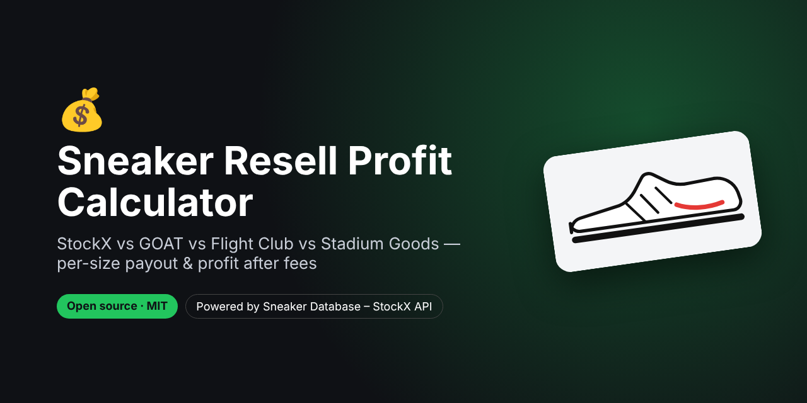
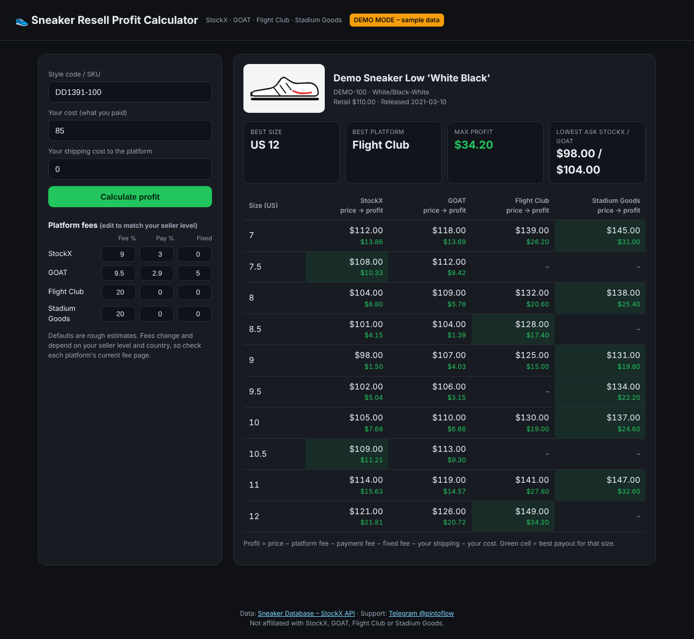

# Sneaker Resell Profit Calculator – StockX vs GOAT vs Flight Club vs Stadium Goods



> **For faster support reply, contact us on Telegram: [@pintoflow](https://t.me/pintoflow)**

**Which platform pays the most for my sneakers?** Enter a style code (SKU), your cost and your fees, and this app shows the **resale price for every size on StockX, GOAT, Flight Club and Stadium Goods**, your **payout after fees** and your **profit**. The best platform for each size is highlighted.

Self-hosted, open source and free. It runs on Node.js with **zero dependencies**.

Powered by the **[Sneaker Database – StockX API](https://rapidapi.com/belchiorarkad-FqvHs2EDOtP/api/sneaker-database-stockx)** on RapidAPI (free plan available).


<sub>Screenshot in demo mode with sample data.</sub>

---

## Why this exists

Resellers search for "StockX vs GOAT which pays more", "StockX fee calculator" and "sneaker resell profit calculator" every day. Most calculators make you type in the sale price yourself. This one pulls the **live per-size price from four marketplaces** for you and does the maths.

## Features

- 🔎 Look up any sneaker by **style code / SKU** (`DD1391-100`, `dd1391 100` and `DD1391100` all work)
- 📊 **Per-size prices** from StockX, GOAT, Flight Club and Stadium Goods side by side
- 💸 **Payout and profit** after platform fee, payment-processing fee, fixed fee and your shipping
- 🏆 Best **size** and best **platform** at a glance
- ⚙️ **Editable fees** for your seller level (saved in your browser)
- 🔒 Your RapidAPI key stays on the server. The browser never sees it.
- ⚡ Built-in caching that matches the API (5 min for prices, 12 h for product data)
- 🧪 **Demo mode** with sample data, so you can try it without a key

## Quick start

```bash
git clone https://github.com/BelNaruto/sneaker-resell-profit-calculator.git
cd sneaker-resell-profit-calculator

# Demo mode (sample data)
node server.js

# Live data
RAPIDAPI_KEY=your_rapidapi_key node server.js
```

Open **http://localhost:3000**.

1. Get a key on **[RapidAPI – Sneaker Database StockX](https://rapidapi.com/belchiorarkad-FqvHs2EDOtP/api/sneaker-database-stockx)**.
2. Requires Node.js 18 or newer. There's nothing to `npm install`.

## How the profit is calculated

```
payout = price × (1 − platform fee %) × (1 − payment fee %) − fixed fee − your shipping
profit = payout − your cost
```

The default fees are **rough estimates** for a new seller. Fees change and depend on your seller level and country, so check each platform's current fee page and edit the fee table in the app.

## API endpoints used

| Endpoint | Used for |
|---|---|
| `GET /stockx/product-by-style?styleId=…` | Product name, image, colorway, retail price, release date |
| `GET /productprice?styleId=…` | Per-size resale prices on StockX, GOAT, Flight Club and Stadium Goods |

Full API docs: **https://rapidapi.com/belchiorarkad-FqvHs2EDOtP/api/sneaker-database-stockx**

## Deploy

It's one Node.js file with no dependencies, so it runs anywhere:

- **Google Cloud Run / Render / Railway / Fly.io**: start command `node server.js`, set the `RAPIDAPI_KEY` environment variable
- **VPS**: `RAPIDAPI_KEY=… PORT=80 node server.js` (or run it with pm2 / systemd)

## Project structure

```
server.js         # zero-dependency server + API proxy with caching
public/index.html # the whole web app (HTML + CSS + JS)
demo-data.json    # sample data used when no key is set
images/           # screenshots
```

## Related projects

- 🔔 [Sneaker Price Alert Bot](https://github.com/BelNaruto/sneaker-price-alert-bot): Discord and Telegram alerts when a StockX price drops
- 📈 [Sneaker Market Dashboard](https://github.com/BelNaruto/sneaker-market-dashboard): trending sneakers, new releases and resale premiums
- 📘 [StockX Sneaker Price API docs and examples](https://github.com/BelNaruto/stockx-sneaker-price-api)

## Support

> **For faster support reply, contact us on Telegram: [@pintoflow](https://t.me/pintoflow)**

API: https://rapidapi.com/belchiorarkad-FqvHs2EDOtP/api/sneaker-database-stockx

---

MIT License. Not affiliated with, endorsed by or sponsored by StockX, GOAT, Flight Club or Stadium Goods.

**Keywords:** sneaker resell calculator, stockx fee calculator, goat fee calculator, stockx vs goat, sneaker profit calculator, resell profit, sneaker payout calculator, flight club, stadium goods, stockx api
